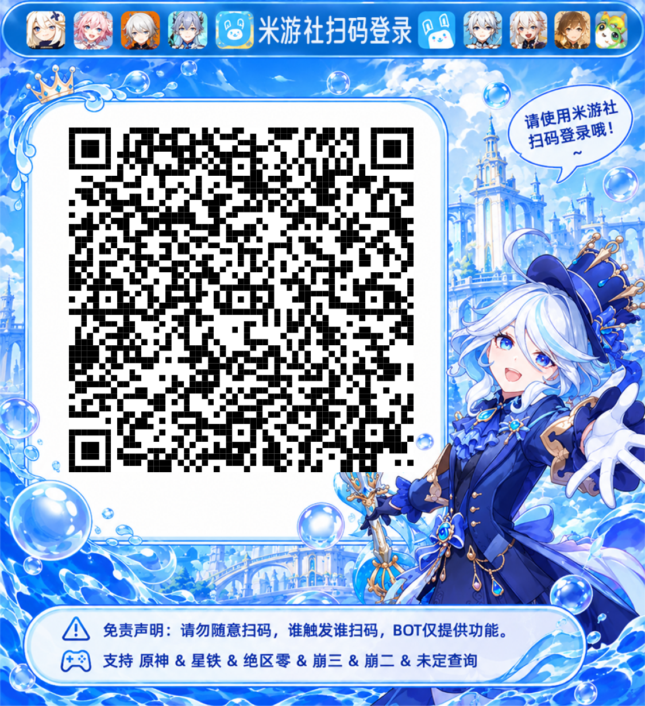

# 扫码登录界面示例

此图由实际模板完整渲染，二维码使用无效测试票据，不含真实登录凭据，**不能用于登录**。
要绑定账号，请向机器人发送 `#扫码登录`，使用本次生成的二维码。

## 模板维护信息

- 背景：`resources/qrCode/furina-qr-code.png`，936 × 1024 像素。
- 二维码：`resources/qrCode/index.html`，左上角坐标 **(100, 185)**，500 × 500 像素。
- 示例沿用扫码入口的 1.2 倍缩放，生成图片为 1123 × 1229 像素；实际尺寸还受插件缩放配置影响。
- 免责声明已包含在背景图中，因此模板不再重复显示底部版权条。

## 本次验证范围

- 私聊、群聊首次扫码和重复触发提示，4 项实际源码隔离回归通过。
- 使用服务器实际公共布局、CSS 和扫码模板进行 Chromium 渲染，没有浏览器错误。
- 示例二维码在原图宽度、480 像素和 360 像素宽度下均可解码。
- 上述为渲染、解码和隔离消息逻辑验证，不代表重新扫码登录的完整端到端实测。
