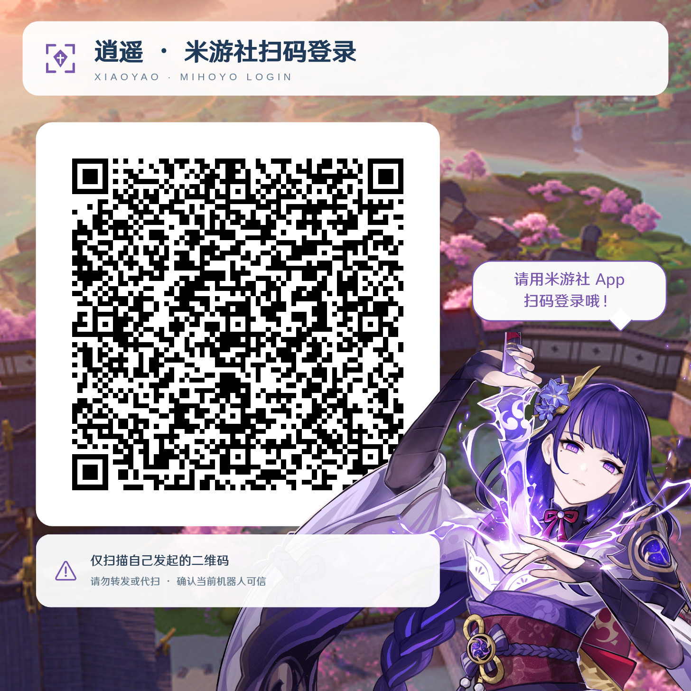

# 扫码登录界面示例

此图为实际模板完整渲染，二维码使用无效测试票据，不含真实登录凭据，**不能用于登录**。
要绑定账号，请发送 `#扫码登录`，使用机器人本次生成的二维码。

## 随机主题

- 内置蒙德、璃月、稻妻、须弥、纳塔、枫丹、挪德卡莱、至冬八地区，34 套角色、39 张风景。
- 每次生成二维码先随机选择角色，再从同地区背景池选择风景；不会混用其他地区背景。
- 素材直接读取本地文件，不在线下载。缺少角色或风景时跳过，全部主题不可用时显示基础二维码。
- 角色气泡提示使用米游社扫码，安全提醒紧贴二维码下方；不显示姓名、地区名，也没有外围白框。
- 雷神使用最开始版的宽幅纯角色透明图；没有用移动端左侧衣袖裁切图，也没有使用抽卡立绘或 AI 补绘。

## 模板维护信息

- 模板：`resources/qrCode/index.html`，1040 × 1040 像素，背景铺满画面四边。
- 主题数据：`resources/qrCode/themes.json`；随机选择：`model/qrTheme.js`。
- 素材：`resources/qrCode/assets/`；[逐项素材来源](../resources/qrCode/SOURCES.md)。
- 二维码卡片左上角 **(54, 184)**，608 × 608 像素；内部码区左上角 **(78, 208)**，560 × 560 像素。
- 二维码包含四模块白色静区，采用 H 纠错；允许少量角色前景重叠，不据此保证任意遮挡都能识别。
- 安全提醒位于 **(54, 804)**，与二维码卡片底部间距 12 像素。
- 模板沿用已验收的 1.4 倍输出比例，实际输出 1456 × 1456 像素。
- 角色源图本身的裁切或淡出未伪造补齐。源图本身不完整时，贴边摆放不等于完整全身。

## 验证与边界

- 主题选择、缺图兜底、URL 安全嵌入：`node --test plugins/xiaoyao-cvs-plugin/tests/qrTheme.test.mjs`（在云崽根目录执行）。
- 已验收 34 套图 × 3 个无效测试码 × 原图/480/360 宽度，ZXing 与 jsQR 均 306/306；交付 JPEG 的 ZXing 检查 102/102。
- 生产模板的 167 种角色/同地区风景组合各验证 3 个无效码，再加基础兜底与中文地址：505 张图 × 三种尺寸，ZXing 与 jsQR 均 1515/1515。
- 基础兜底版不显示角色，二维码适度放大；地址中的中文等非 ASCII 字符通过 UTF-8 字节桥接交给原编码器。
- 真实 `Common → adapter → JiuLi 渲染器 → Chromium` 路径验证了主题版与基础兜底版，图片能解码；未发送真实消息。
- 渲染与解码验证不代表手机米游社扫码登录端到端实测，也不能保证所有手机、所有票据长度可识别。
